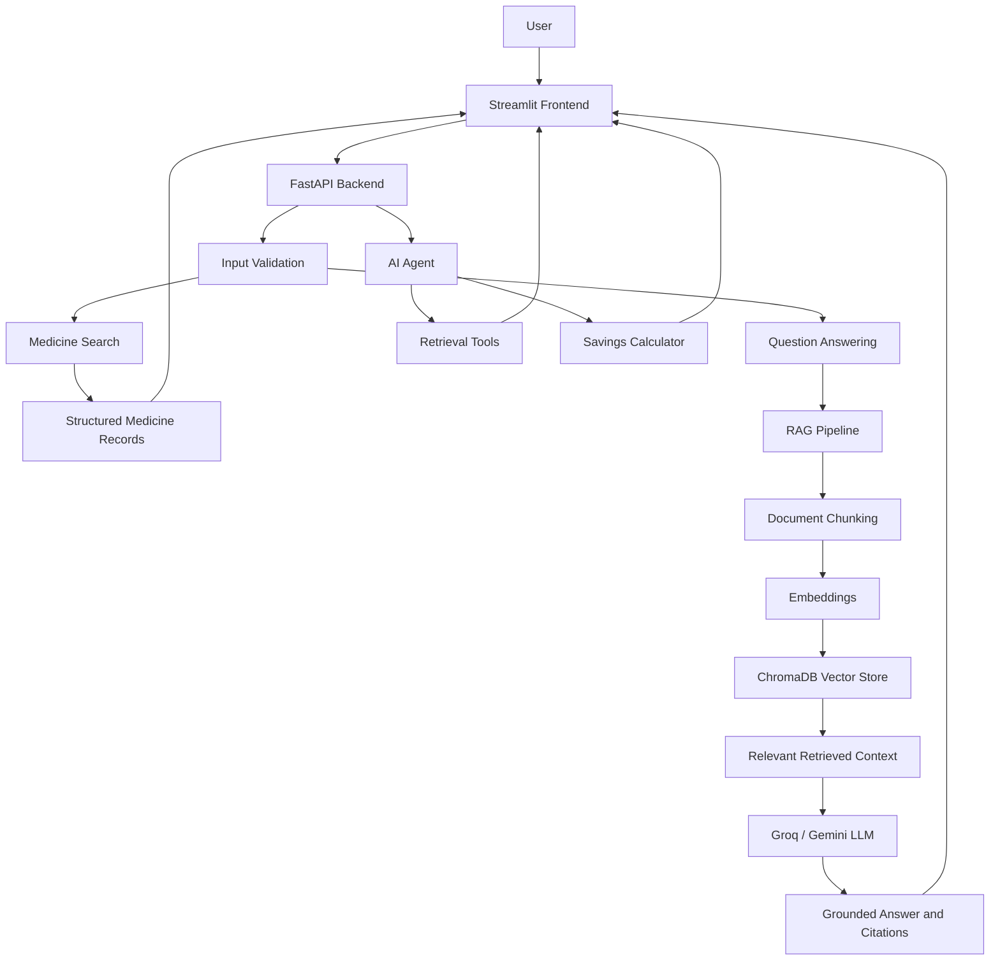

# JanAushadhiFinder 💊
### AI-Powered Generic Medicine Discovery and Savings Assistant

[](https://github.com/prachihirave8329/SU-genAI/actions/workflows/ci.yml)

[](https://www.python.org/)
[](https://fastapi.tiangolo.com/)
[](https://github.com/prachihirave8329/SU-genAI)
[](https://github.com/prachihirave8329/SU-genAI)

JanAushadhiFinder is a GenAI-powered application designed to help patients and caregivers explore affordable generic medicines, access medicine-related information, and understand potential cost savings.

It combines structured medicine data processing, intelligent search, Retrieval-Augmented Generation (RAG), semantic retrieval, and an AI-powered assistant to provide useful, evidence-grounded information.

**GitHub Repository:** https://github.com/prachihirave8329/SU-genAI

**Live Application:**
- Frontend: https://jan-aushadhi-ui.onrender.com
- Backend API: https://jan-aushadhi-api-1sk5.onrender.com
- API Health Check: https://jan-aushadhi-api-1sk5.onrender.com/health
- Swagger Documentation: https://jan-aushadhi-api-1sk5.onrender.com/docs

---

## 1. Project Card

| Field | Description |
|---|---|
| Product | JanAushadhiFinder |
| Target Users | Patients, caregivers, and people looking for affordable generic medicines |
| Problem | Difficulty finding reliable generic medicine information and understanding potential savings |
| Data Source | Official PMBI / Janaushadhi website and medicine catalogue information |

## 2. Problem Statement

Patients and caregivers may face difficulties when trying to:

- Find information about affordable generic medicines.
- Understand medicine details from lengthy official documents.
- Search medicine catalogues using natural-language queries.
- Compare branded and generic medicine prices.
- Identify reliable information without depending on unsupported AI-generated answers.

JanAushadhiFinder aims to simplify access to generic medicine information through data processing, intelligent search, and evidence-grounded AI responses.

## 3. Project Features

### Medicine Data Processing
- Fetches information from official PMBI web pages.
- Cleans and processes medicine records.
- Stores structured medicine information in JSON format.
- Uses Pandas for data exploration and analysis.

### Intelligent Medicine Search
- Retrieves all medicine records with optional limits.
- Retrieves individual records using drug codes.
- Supports case-insensitive medicine searches.
- Uses TF-IDF and cosine similarity for text-based search.
- Supports medicine-name and strength matching.

### GenAI and RAG
- Accepts natural-language questions through REST APIs.
- Retrieves relevant document chunks using semantic search.
- Uses ChromaDB as a vector store.
- Generates responses using Groq or Gemini.
- Grounds answers in retrieved document context.
- Validates generated citations against retrieved source chunks.
- Abstains when sufficient supporting information is unavailable.

### Medicine Savings Calculator
- Compares branded and generic medicine prices when matching data is available.
- Provides a Same Salt, Same Strength comparison concept.
- Calculates potential monthly and yearly savings.

### AI Agent
- Supports tool-based question handling.
- Connects retrieval and savings-calculation functionality.
- Uses an agent workflow for multi-step question processing.

### Production Readiness
- API request-latency logging.
- LLM response-latency logging.
- Prompt, completion, and total token tracking.
- Bounded LRU response caching with configurable expiration.
- Input validation and request-length restrictions.
- Prompt-injection regression testing.
- Automated testing and linting.

## 4. Technology Stack

| Category | Technologies |
|---|---|
| Programming Language | Python |
| Backend | FastAPI, Uvicorn |
| Frontend | Streamlit |
| Data Processing | Pandas |
| Search | Scikit-learn, TF-IDF, Cosine Similarity |
| Generative AI | Groq, Gemini |
| RAG | Embeddings, Chunking, Semantic Retrieval |
| Vector Database | ChromaDB |
| AI Agent | LangGraph, Custom Agent Workflow |
| API Validation | Pydantic |
| Testing | Pytest |
| Code Quality | Ruff |
| Containerization | Docker, Docker Compose |
| Deployment | Render |
| CI/CD | GitHub Actions |
| Version Control | Git, GitHub |

## 5. System Architecture



### Request Workflow

1. The user submits a medicine query or natural-language question through the frontend.
2. FastAPI receives and validates the request.
3. Structured search or the RAG pipeline processes the query.
4. The RAG pipeline retrieves relevant document chunks from ChromaDB.
5. Retrieved context is supplied to the configured LLM provider.
6. The LLM generates a response using the available evidence.
7. The application validates the generated citations.
8. The frontend displays the response and supporting information.

## 6. Project Structure

```text
SU-genAI/
│
├── app/
│   ├── main.py
│   ├── llm.py
│   ├── rag.py
│   ├── chunking.py
│   ├── vectorstore.py
│   ├── schema.py
│   ├── smart_search.py
│   ├── records.py
│   ├── services.py
│   ├── agent_api.py
│   ├── agent_loop.py
│   ├── models.py
│   ├── ingest.py
│   └── fetch.py
│
├── analysis/
│   └── explore.py
│
├── data/
│   ├── raw/
│   └── records.json
│
├── evaluation/
│   └── retrieval_dataset.json
│
├── eval/
│   └── rag_eval_results.json
│
├── tests/
│   ├── test_api.py
│   ├── test_records.py
│   ├── test_vectorstore.py
│   └── test_prompt_injection.py
│
├── requirements.txt
├── Dockerfile
├── docker-compose.yml
└── README.md
```

*This is a representative project structure. Update filenames to match the actual files in your repository.*

## 7. API Endpoints

| Method | Endpoint | Description |
|---|---|---|
| GET | `/` | API welcome information |
| GET | `/health` | Check API health |
| GET | `/records` | Retrieve medicine records |
| GET | `/records?limit=2` | Retrieve limited records |
| GET | `/records/{id}` | Retrieve a record by drug code |
| GET | `/search?q=paracetamol` | Search medicine records |
| GET | `/search/semantic?q=medicine` | Perform semantic search |
| POST | `/questions` | Submit a medicine-related question |
| POST | `/chat` | Generate an AI chat response |
| POST | `/ask` | Ask a question using the RAG pipeline |

Interactive API documentation is available at:

https://jan-aushadhi-api-1sk5.onrender.com/docs

## 8. RAG Evaluation – Day 8

### Evaluation Dataset

The retrieval pipeline was evaluated using a dataset of 15 questions.

- Total questions: 15
- Answerable questions: 13
- Abstention questions: 2
- Evaluation method: Compare retrieval configurations using the same question set.

### Configuration Comparison

| Parameter | Configuration A | Configuration B |
|---|---:|---:|
| Chunk Size | 500 | 300 |
| Chunk Overlap | 50 | 50 |
| Top K | 3 | 5 |
| Answer Accuracy | 66.67% | 86.67% |
| Abstention Accuracy | 100% | 100% |

### Evaluation Results

Configuration B achieved an answer accuracy of **86.67%**, compared with 66.67% for Configuration A.

It correctly answered 13 out of 15 questions and correctly abstained on both questions requiring unavailable real-time stock information.

### Conclusion

Configuration B was selected as the better-performing configuration in this evaluation.

Smaller chunks and a higher retrieval count provided more relevant context for answering questions. Since chunk size and Top K changed together, further controlled experiments are required to measure their individual effects.

**Evaluation output:** `eval/rag_eval_results.json`

## 9. Production Readiness – Day 13

The application includes basic production-oriented monitoring, caching, input validation, and security regression testing.

### 9.1 API Latency Monitoring

The FastAPI backend logs:
- HTTP request method.
- Request endpoint.
- Response status code.
- API request latency in milliseconds.

This helps identify slow API requests and monitor backend performance.

### 9.2 LLM Latency and Token Tracking

LLM requests record:
- Provider name.
- Model name.
- Request latency.
- Prompt token count.
- Completion token count.
- Total token count.
- Cache-hit status.
- Request outcome.

User prompts and generated response content are not included in these logs.

### 9.3 Response Caching

An in-memory LRU cache reduces repeated calls to the LLM provider.

| Configuration | Value |
|---|---:|
| Maximum Cache Entries | 128 |
| Default Cache TTL | 300 seconds |
| Cache Policy | LRU |
| Cache Expiration | Time-based |
| Cache Storage | In-memory |

**Cache workflow:**

1. A user submits a question.
2. The application generates a cache key using the provider, model, system prompt, and user prompt.
3. It checks whether a valid cached response exists.
4. If found, the cached response is returned without another provider request.
5. Otherwise, the LLM generates a response, which is cached after successful generation.

The cache is instance-local and is cleared when the application restarts. Separate application instances maintain separate caches.

### 9.4 Input Validation

Pydantic request schemas validate incoming API data.

Input validation helps reject empty, invalid, or excessively long requests before they reach the LLM pipeline.

### 9.5 Prompt-Injection Regression Testing

A dedicated test checks whether malicious user instructions can override the RAG system instructions.

The test verifies that:
- System-level grounding instructions remain present.
- User input remains separate from system instructions.
- The tested malicious request receives an abstention response.
- Unsupported citations are not returned.

This is a regression test for the tested scenario, not a guarantee that the application is immune to all prompt-injection attacks.

## 10. Testing and Code Quality

The project uses Pytest for automated testing and Ruff for code-quality checks.

### Latest Local Test Result

```text
29 passed in 3.50s
```

### Tested Areas

- API health and medicine search endpoints.
- RAG question-answering endpoint.
- Prompt-injection regression scenario.
- Medicine record loading and searching.
- Case-insensitive medicine search.
- Exact medicine-name and strength matching.
- Savings calculation.
- Invalid medicine and price handling.
- Vectorstore query expansion.
- Retrieval scoring and relevance.

### Run Tests

```bash
pytest -v
```

### Run Ruff

```bash
ruff check .
```

## 11. Installation and Local Setup

### Prerequisites

- Python installed.
- Git installed.
- Docker Desktop for containerized execution.
- A Groq or Gemini API key.

### 1. Clone the Repository

```bash
git clone https://github.com/prachihirave8329/SU-genAI.git

cd SU-genAI
```

### 2. Create and Activate a Virtual Environment

```bash
python -m venv .venv
```

Windows PowerShell:

```powershell
.\.venv\Scripts\Activate.ps1
```

### 3. Install Dependencies

```bash
pip install -r requirements.txt
```

### 4. Configure Environment Variables

Create a `.env` file in the project root.

```env
LLM_PROVIDER=groq

GROQ_API_KEY=your_groq_api_key
GROQ_MODEL=llama-3.3-70b-versatile

GEMINI_API_KEY=your_gemini_api_key
GEMINI_MODEL=gemini-2.5-flash

LLM_CACHE_TTL_SECONDS=300
```

Use the provider configured for your application. Never commit `.env` or expose API keys publicly.

### 5. Run the FastAPI Application

```bash
python -m uvicorn app.main:app --reload
```

### 6. Open API Documentation

Visit:

http://127.0.0.1:8000/docs

### 7. Run Data Exploration

Open another terminal, activate the virtual environment, and execute:

```bash
python analysis/explore.py
```

## 12. Run with Docker

### Prerequisites

- Docker Desktop installed and running.
- Docker Compose available.
- A valid `.env` file containing the required API credentials.

### 1. Clone the Repository

```bash
git clone https://github.com/prachihirave8329/SU-genAI.git

cd SU-genAI
```

### 2. Configure Environment Variables

Create a `.env` file in the project root.

Add the required environment variables used by the application.

Do not commit your `.env` file or expose API keys publicly.

### 3. Build and Start the Application

```bash
docker compose up -d --build
```

This command builds and starts the configured application services:

- **FastAPI backend:** Handles API requests and AI workflows.
- **Streamlit frontend:** Provides the user interface.
- **ChromaDB volume:** Persists vector database data across container restarts.

### 4. Verify Running Containers

```bash
docker compose ps
```

### 5. Access the Application

- Streamlit UI: http://localhost:8501
- FastAPI Swagger documentation: http://localhost:8000/docs

### 6. View Application Logs

```bash
docker compose logs -f
```

### 7. Stop the Application

```bash
docker compose down
```

The named ChromaDB volume is preserved when using `docker compose down`.

To remove containers, networks, and the persistent database volume:

```bash
docker compose down -v
```

**Warning:** The `-v` option deletes the persistent ChromaDB volume and its stored data.

## 13. Live Deployment

JanAushadhiFinder is deployed on Render.

| Component | Live URL |
|---|---|
| Frontend UI | https://jan-aushadhi-ui.onrender.com |
| Backend API | https://jan-aushadhi-api-1sk5.onrender.com |
| API Health Check | https://jan-aushadhi-api-1sk5.onrender.com/health |
| API Documentation | https://jan-aushadhi-api-1sk5.onrender.com/docs |

### Health Check

The API provides a public `/health` endpoint to verify service availability.

Test using PowerShell:

```powershell
curl.exe https://jan-aushadhi-api-1sk5.onrender.com/health
```

### Deployment Platform

- **Frontend:** Render
- **Backend:** Render
- **Containerization:** Docker

## 14. Production Performance Measurements

The application logs request latency and LLM token usage. The following measurements should be recorded from actual deployed requests before making performance claims.

| Metric | Measured Result |
|---|---|
| Average API latency | To be measured |
| Average LLM latency | To be measured |
| Cache-hit latency | To be measured |
| Prompt tokens | To be measured |
| Completion tokens | To be measured |
| Total tokens | To be measured |

These values should be collected from Render logs. Do not treat cache-hit token counts of zero as the original provider request's token usage.

## 15. Demo

**Project Demo Video:** Add your recorded demonstration video link here.

Suggested demonstration flow:

1. Introduce the problem JanAushadhiFinder addresses.
2. Search for a generic medicine.
3. Show medicine information and matching strength.
4. Demonstrate the Same Salt, Same Strength comparison.
5. Ask a natural-language question.
6. Show the RAG-generated answer and citations.
7. Demonstrate the savings calculator.

## 16. Future Improvements

- Improve medicine-name normalization for combination salts.
- Improve extraction accuracy from complex PMBI PDF tables.
- Expand the RAG evaluation dataset.
- Introduce persistent distributed caching for multiple application instances.
- Add performance-monitoring dashboards.
- Improve location-based Jan Aushadhi Kendra discovery using verified location data.

## 17. Medical Disclaimer

JanAushadhiFinder is an informational application. It does not provide medical diagnoses, prescribe medicines, or replace professional medical advice.

Users should consult a qualified healthcare professional before changing or substituting prescribed medicines.

Medicine availability and prices may vary. Always verify current information through official sources or authorized providers.

## 18. Author

**Prachi Sunil Hirave**

B.Tech Computer Science and Engineering

GitHub: https://github.com/prachihirave8329

Project Repository: https://github.com/prachihirave8329/SU-genAI

---

*Built as a practical exploration of Python backend engineering, data processing, semantic search, Retrieval-Augmented Generation, and responsible GenAI application development.*
