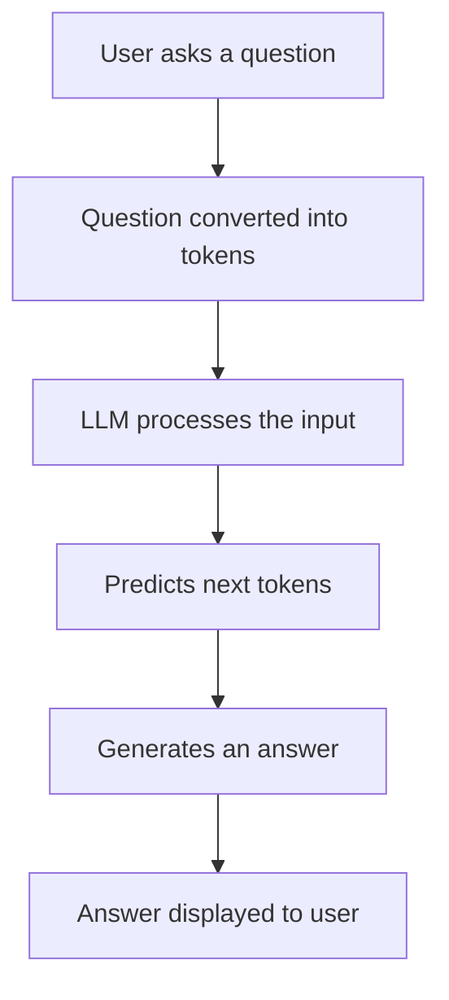

# How Large Language Models (LLMs) Work

## 1. What is an LLM?

LLM stands for Large Language Model.

It is an Artificial Intelligence model trained on a very large
amount of text data. It learns how words, sentences and language
patterns are connected.

An LLM predicts the next token based on the tokens it has
already received.

A token can be a complete word, part of a word or a symbol.

## 2. How does an LLM work?

1. The user enters a question.
2. The question is converted into tokens.
3. The model processes those tokens.
4. The model predicts the next token.
5. This process continues until an answer is generated.
6. The generated answer is displayed to the user.

## 3. Important concepts

### Training
The model learns language patterns from large amounts of
training data.

### Tokens
Tokens are small units of text processed by the model.

### Context
Context is the information available to the model while
generating a response.

### Prompt
A prompt is the instruction or question given to the model.

### Inference
Inference is the process of using a trained model to
generate an answer.

## 4. How LLMs can help JanAushadhiFinder

JanAushadhiFinder helps patients and caregivers find
information about affordable generic medicines.

An LLM can help the application:

- Understand questions written in natural language.
- Explain medicine information in simple language.
- Generate easy-to-understand responses.
- Handle different ways of asking the same question.

However, the model should not invent medicine prices,
availability or medical information.

It should use reliable information from the available
medicine dataset.

## 5. Limitations of LLMs

- They can generate incorrect information.
- They may not know the latest medicine prices.
- They cannot confirm live medicine stock without a
  reliable live data source.
- They should not replace doctors or pharmacists.

## 6. Basic workflow diagram

## 7. Conclusion

LLMs make applications more interactive by understanding
and generating human-like language.

In JanAushadhiFinder, an LLM can improve how users interact
with medicine information, but answers must be grounded in
reliable data.
